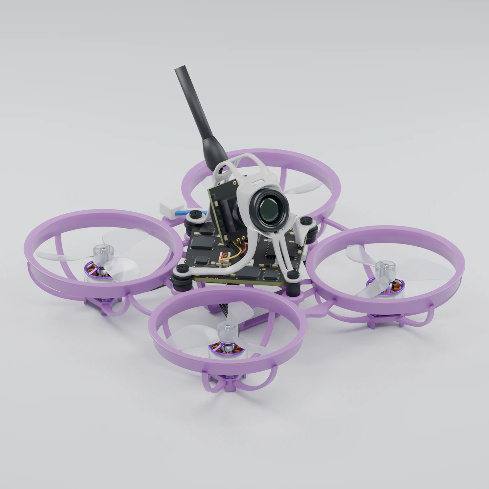

# Parametric BETAFPV Air65 II Racing recreation

A sourced reconstruction of the **Air65 II Racing**, built from independently researched dimensions and reference imagery, a single spatial contract, and component JSON authored by specialist Codex agents. A small local Python interpreter turns the data into editable Blender objects and renders. Agent orchestration takes place inside Codex; the project has no OpenAI API integration.

This project distinguishes **published nominal dimensions**, **derived geometry**, and **visual estimates**. It does not claim to replace a measured physical specimen or the manufacturer's CAD. Read `reports/validation_report.md` for the actual validation results and remaining shape uncertainties.

The current refinement addresses the user's Sketchfab comparison while retaining the selected Air65 II configuration. It includes a continuous formed canopy, a centrally revised photographic PCB outline, authored board/battery textures and a separately optimized browser asset. Read `reports/refinement_validation.md` and `reports/refinement_independent_visual_review.md` for current results and remaining limits; the prior delivery is preserved under `output/refinement_baseline/`.

Public interactive viewer: **https://air65-ii-explorer.danohn.chatgpt.site**. The `site/` directory contains the buildless Three.js source. The viewer supports rotation, zoom, pan, component visibility, camera presets, an illustrative exploded view and optional battery display.

GitHub source: **https://github.com/danohn/air65**. Download the editable projects, renders and historical comparison inputs from **[release v0.1.0](https://github.com/danohn/air65/releases/tag/v0.1.0)**. Source, specifications, review evidence and one ready-to-use web model are tracked; generated `output/` files are restored from the release or built locally. See [release restoration](docs/RELEASES.md) and [repository/publishing layout](docs/REPOSITORY.md).



To populate the artifact paths referenced below after a fresh clone:

```sh
uv sync --python 3.14 --frozen
uv run scripts/restore_release.py
```

## Open the results

- `output/final/air65_ii.blend`: editable dry aircraft, separate component collections and cameras.
- `output/final/hero.png` and seven other views: final 1400px renders, with a combined `multiview.png` contact sheet.
- `output/with_battery/air65_ii.blend`: optional LAVA II 280mAh battery configuration.
- `output/frame_final/`: final isolated frame inspection views. `output/frame/` preserves the first-review baseline.
- `output/prototype/`: the deliberately simple prototype retained as evidence of the staged workflow.
- `reports/validation_report.md`: measurement checks, independent visual review, revisions, and limits.
- [Release downloads](https://github.com/danohn/air65/releases/tag/v0.1.0): artifact and baseline ZIPs, individual Blender/GLB files and multiview image. `releases/v0.1.0.json` pins archive URLs, sizes and hashes. The older local `dist/air65_ii_project.zip` includes research photographs and is not the public release package.

## Reproduce locally

The external scripts use uv-managed Python 3.14. Blender runs its own bundled Python; do not install `bpy` into the uv environment. The tested binary is Blender **5.2.2 LTS**, build `d13f752e3b9c`, at `/Applications/Blender.app/Contents/MacOS/Blender` on this Mac. Other installations can pass `--blender /absolute/path/to/blender` or set `BLENDER_BIN`.

```sh
uv sync --python 3.14
uv run pytest -q
uv run python scripts/build.py
uv run python scripts/validate_model.py
```

The default build writes the final project and eight images at 1100px, 48 samples, using Cycles CPU and seed 6502. Useful alternatives:

```sh
# Validate JSON and resolve all shared references without launching Blender.
uv run python scripts/build.py --validate-only

# Faster geometry/lighting iteration.
uv run python scripts/build.py --output output/preview --resolution 700 --samples 20 --views hero,top,right

# Reproduce the delivered render resolution and sample count.
uv run python scripts/build.py --output output/final --resolution 1400 --samples 64

# Isolated frame and optional battery assembly.
uv run python scripts/build.py --assembly specs/frame_assembly.json --output output/frame_final --views hero,top,front,underside
uv run python scripts/build.py --assembly specs/assembly_with_battery.json --output output/with_battery --views hero,underside
uv run python scripts/validate_model.py --assembly specs/assembly_with_battery.json --output output/with_battery --required-views hero,underside

# Independent regeneration for semantic geometry repeatability.
uv run python scripts/build.py --output output/rebuild_check --no-render

# Reopen the saved file and check geometry and editability.
/Applications/Blender.app/Contents/MacOS/Blender --background --factory-startup output/final/air65_ii.blend --python-exit-code 1 --python scripts/inspect_saved.py -- --output output/final/reopen_validation.json

# Check the optional battery's saved body dimensions and targeted frame fit.
/Applications/Blender.app/Contents/MacOS/Blender --background --factory-startup output/with_battery/air65_ii.blend --python-exit-code 1 --python scripts/inspect_battery.py -- --output output/with_battery/fit_validation.json

# Contact sheets and portable package, after validation/reporting is complete.
uv run python scripts/make_contact_sheet.py
uv run python scripts/package.py
```

`build.log`, `resolved_assembly.json`, `metrics.json`, and `validation.json` describe each result. `render_manifest.json` binds each completed PNG's checksum to its source inputs and render settings. A geometry fingerprint is computed from named evaluated vertices, polygon indices, and material names. Source hashes identify the exact JSON contract and interpreter. The claim is repeatable geometry under the tested Blender build, not byte-identical `.blend` files or identical pixels across different Blender versions/devices. Historical review directories are snapshots: their older hashes should not be expected to match current source files.

## Edit the model

`specs/spatial_architecture.json` owns every important shared scalar. The right-handed coordinate system uses +X to aircraft right, +Y forward, and +Z up. Z0 is the lowest plastic frame datum. Author all lengths in millimetres and angles in degrees. The interpreter converts millimetres to Blender SI metres once; the scene displays millimetres.

Components use references such as `{"param":"duct_inner_radius"}`. Only a numeric `scale` and `offset` may be added; there is no expression evaluator. `specs/component.schema.json` rejects unknown operations and properties. See `specs/GEOMETRY_CONTRACT.md` for supported geometry and modifier semantics.

The `.blend` contains separate meshes, editable wire curves, UV layers, packed authored textures, materials and retained modifiers, plus the resolved source JSON in a Text datablock. You can edit geometry directly in Blender. Those manual changes are not written back to JSON and will be replaced by regeneration. For reproducible changes, edit component JSON or the central parameter registry and rebuild.

The model is parametric within this established Air65 II layout. Important sizes and placements are referenced centrally; small surface details and image-traced shapes include estimated local coordinates. The registry is not a dependency solver: derived motor offsets, camera coordinates and mount radii are stored values. Changing wheelbase, camera tilt or mounting pitch requires coordinated recalculation, and some generated mesh offsets (such as pad-hole centers on the frozen 6.6mm PCD) require regeneration. A regression test verifies that antenna-aperture edits no longer move the mounting legs. Arbitrary independent scalar, topology or layout changes still require authoring work and a new validation/review pass.

## Evidence and variant control

The baseline is the current manufacturer **Racing** configuration: standard lavender Air65 II frame, white Air II canopy, clear GF1207 three-blade props, 2026 30000KV silver/purple motors, Matrix 1S 5IN1 II with motor sockets, C03 V2 camera, and black copper-tube antenna. It does not mix in the Champion frame or Freestyle propeller.

Key source nominals are 65mm diagonal motor spacing, 82.6 × 82.6 × 15.1mm frame envelope, 33mm duct clear ID, 3.8mm upper duct band, 31mm propeller swept diameter, and 9mm motor body OD. The complete aircraft is taller than the frame. Camera pose, canopy shape, vertical mounting stack, antenna, and small component details have explicitly estimated dimensions.

The manufacturer lists a **25.5mm frame mounting pitch and 26mm FC mounting pitch**. Both are retained. Screw axes follow the frame; inferred grommet compliance bridges the 0.354mm radial difference. This is an assembly assumption, not a verified manufacturing tolerance.

The camera uses a selected official 25° adjustment setting; the exact stock-photo adjustment is unknown. The optional battery is the documented 280mAh, 54 × 10 × 6mm pack. The manufacturer's underside reference shows a longer 320mAh pack, so it is not treated as equal in length.

- Primary sources: [Air65 II aircraft](https://betafpv.com/products/air65-ii-brushless-whoop-quadcopter), [standard frame](https://betafpv.com/products/air65-ii-brushless-whoop-frame), [Air II canopy](https://betafpv.com/products/air-ii-canopy), [2026 motors](https://betafpv.com/products/0702-brushless-motors-2026), [GF1207 propellers](https://betafpv.com/products/gemfan-1207-3-blade-propellers-1-0mm-shaft), [Matrix II FC](https://betafpv.com/products/matrix-1s-5in1-ii-brushless-flight-controller), [C03 camera](https://betafpv.com/products/c03-fpv-micro-camera), [LAVA II battery](https://betafpv.com/products/lava-ii-1s-battery).
- Physical appearance cross-check: [The Drone Vortex hands-on review](https://thedronevortex.com/betafpv-air65ii-review/). Its Racing sample has turquoise motor accents; the current manufacturer version modelled here uses purple accents. Review prose is not used as dimensional authority.

`research/dimensions.json`, `research/appearance.json`, and `research/modelling.json` preserve the independent research. `specs/design_spec.json` consolidates it. The reference manifests record URLs, variants, image hashes and provenance. Manufacturer images may be renders or retouched studio images; the exact capture method is not stated. Real review photographs provide additional visual evidence but are not calibrated.

Reference-image copyright remains with the original owners. Downloaded photographs are retained only in the local research workspace; the GitHub repository and public release archives include their provenance manifests and source links instead. The old photo-containing `reports/visual_comparison.png` is also excluded. No open redistribution license is claimed. Generated meshes do not use those images as textures or import manufacturer CAD. The modelling-method report records investigated open-source tools and skills; the runtime itself needs no add-ons. See [attribution](docs/ATTRIBUTION.md).

## Workflow record

Read `IMPLEMENTATION_PLAN.md`, `REFINEMENT_PLAN.md`, `reports/prototype_validation.md`, and the component and review reports. Three independent research agents ran first; the main agent consolidated their findings; a spatial architect established the single coordinate and parameter contract; the minimal prototype was built and inspected; three component agents then authored separate files. The main agent owns the renderer, schema, materials, assembly, validation and integration. An independent reviewer compares rendered geometry with references before the final revision.


## Reproduce the refinement and browser asset

The JSON files remain the renderer input. The component authoring helpers can regenerate the formed canopy and the original printed artwork; their shared measurement authority is still `specs/spatial_architecture.json`.

The source build and contract tests work directly from a clone. Historical comparison scripts require the restored baseline; the old `make_contact_sheet.py` photo-comparison section also requires the locally obtained third-party reference photo. Its eight-view model contact sheet is already provided in the release.

```sh
uv run scripts/refine_canopy.py
uv run scripts/refine_electronics.py
uv run scripts/refine_battery.py
uv run scripts/build.py --resolution 1400 --samples 64
uv run scripts/build.py --assembly specs/assembly_with_battery.json --output output/with_battery --resolution 1400 --samples 64 --views hero,underside,right
```

Export the detailed source and the separate optimized browser mesh:

```sh
/Applications/Blender.app/Contents/MacOS/Blender --background --factory-startup --python-exit-code 1 --python scripts/export_web_model.py -- --source output/with_battery/air65_ii.blend --output output/web/air65-ii.glb
/Applications/Blender.app/Contents/MacOS/Blender --background --factory-startup --python-exit-code 1 --python scripts/export_web_model.py -- --source output/with_battery/air65_ii.blend --mode optimized --output output/web_optimized/air65-ii.glb --save-preview-blend
```

`output/web/` retains the complete evaluated source geometry. `output/web_optimized/` is the browser representation with a per-object optimization audit, embedded textures and preserved component transforms. The optimized `preview.blend` contains evaluated meshes for comparison; it is not the editable procedural source. The exporter protects shared canopy normals, UV seams and dimensional anchors and reverts candidates that exceed the declared sampled-distance/bounds gates. These are source-to-export checks, not physical accuracy certification.

The browser benchmark is an explicit local page, not an inferred performance score:

```sh
uv run scripts/write_browser_benchmark.py
uv run --python 3.14 python -m http.server 8765 --bind 127.0.0.1
```

Open `http://127.0.0.1:8765/output/browser_benchmark/index.html` and run the comparison while the page is visible and no Blender render is active. It runs three interleaved rounds of original, refined detailed and refined optimized assets, with 60 warmup and 240 measured frames each at a fixed 960 × 720 drawing buffer, DPR 1. Results appear as JSON on the page; save that text to `reports/browser_performance.json` to replace the included completed run. Run `uv run scripts/summarize_refinement.py` and `uv run scripts/write_refinement_report.py` to refresh the reports. This is a local rendering comparison, not an internet-loading or cross-device benchmark.
