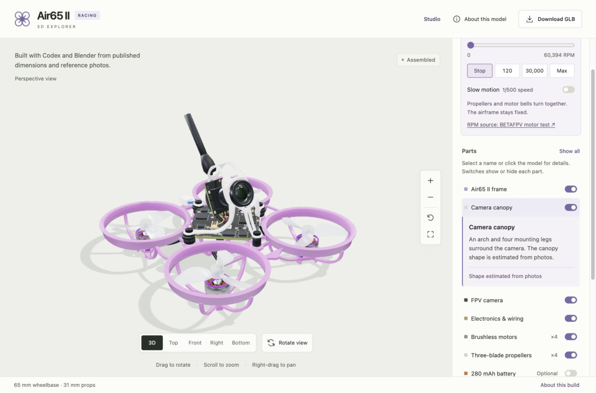
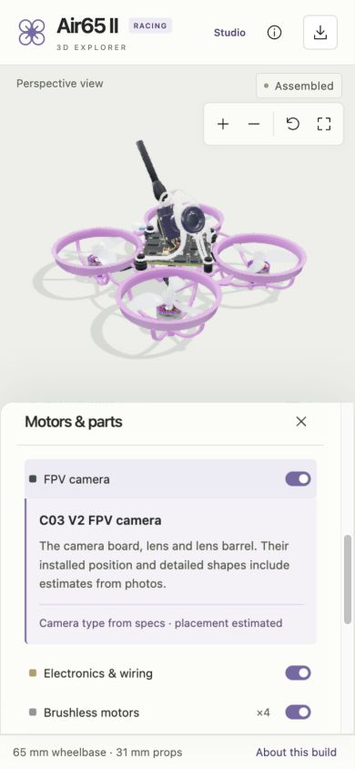
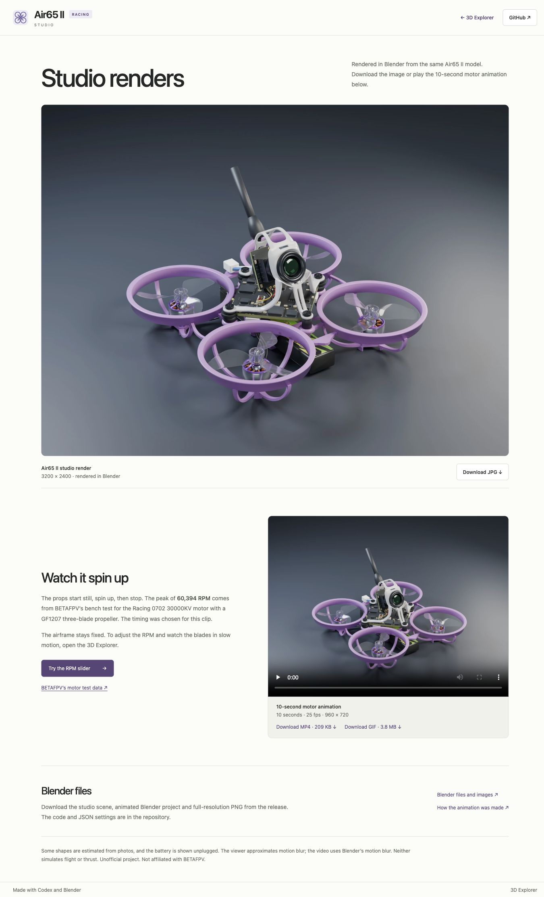

# Site copy, component details and readability

Checked on 12 October 2026 against the local static site. This applies to the Explorer and Studio pages; model geometry, media and source measurements are unchanged.

## Changes

- Replaced the repeated slogans with the project's purpose: reconstructing the Air65 II with Codex, Blender, published dimensions and reference photos.
- Shortened About and Studio, retained the dimension table and estimate notes, and linked directly to the measurement report. Download labels identify GLB and JPG files. The camera control is labelled “Rotate view”.
- Selected component notes now sit immediately after their row. The inspector reveals the row and notes without moving the camera. Selecting the same row again collapses it. Buttons expose their expanded state and identify the detail region.
- Removed decorative counts of one, used “×4” for motors and props, and expanded “OPT” to “Optional”.
- Increased helper text, source links and the phone footer to 12 px; component descriptions are 13 px and About/Studio prose is 14 px. Darkened secondary text and slightly widened the desktop inspector.
- Kept the phone panel's heading and close button visible while scrolling. Opening the panel from its button focuses the close control; closing returns focus to the opener.

## Validation

JavaScript syntax validation and the existing four Node motion tests pass. The tests cover RPM integration, blur, moving versus fixed nodes in the shipped GLB, pause, slow motion, reset and separated-part offsets. No geometry or Blender rebuild was needed for this change.

Browser checks used the Codex in-app browser at 1365 × 900, 390 × 844 and 320 × 740. Phone sizes were emulated.

- Selected all seven component categories at the narrowest phone size. Each detail region immediately followed its selected row, exposed the expanded state, stayed below the sticky heading and fit within the panel. No horizontal document overflow was observed.
- Checked desktop canopy and battery selection, keyboard activation/collapse, hiding the selected canopy and reset. Hiding the selected part closes its notes. Reset restores the canopy and clears selection.
- Clicked the rendered camera directly at phone size. The parts panel opened and revealed the camera description automatically.
- Checked 30,000 RPM and slow motion: the helper text showed 60 RPM at 1/500 playback speed. Reset returned the motors to zero.
- Inspected About on desktop and Studio at desktop and phone sizes. Studio retains its media/download links and `preload="none"` on the video.
- No browser console errors or warnings were captured during the checked interactions.

Text contrast was calculated from the browser's computed foreground and opaque background colours:

| Text | Size | Contrast |
| --- | --- | --- |
| Part instructions | 12 px | 5.69:1 |
| Component description | 13 px | 6.76:1 |
| Component source/estimate note | 12 px | 6.15:1 |
| Motor source link | 12 px | 6.12:1 |
| Footer | 12 px | 5.69:1 |

The audit recorded part instructions at 10 px / 2.92:1 and the phone footer at 7 px / 3.10:1. This is a focused readability and interaction check, not a complete accessibility or cross-browser certification. The phone panel still combines motors and parts in one scrollable panel; separate tabs remain outside this pass.

## Publication

Published as site version 4 at [air65-ii-explorer.danohn.chatgpt.site](https://air65-ii-explorer.danohn.chatgpt.site/). The native deployment returned `succeeded`. The published Explorer was checked with desktop canopy selection and phone camera selection, and the Studio page was inspected after deployment. Source and archive identifiers are recorded in [copy_readability_deployment.json](copy_readability_deployment.json).

